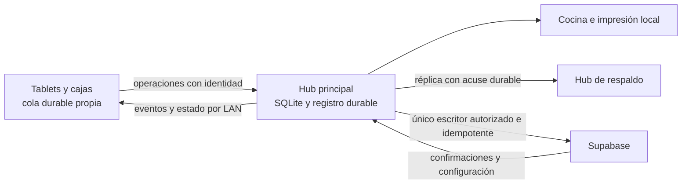

# Plan completo: Hub local e integridad de ventas de Food Shop

Fecha: 10 de octubre de 2026. Zona horaria: America/Santo_Domingo.

**Alcance (dueño, 10-oct): este plan es para TODOS los negocios, no solo Food Shop.** Food Shop es el caso que lo originó y el primero en recibirlo. Orden acordado: primero se termina la fase 2 en curso (cuentas en revisión, ver PENDIENTES 1.5) y después este plan.

Estado: plan de implementación y despliegue; no certifica producción. Base de revisión: HEAD `77b5b036` y cambios locales presentes al redactarlo. Hay trabajo simultáneo en ventas: fijar un commit antes de ejecutar cada etapa y volver a revisar lo que cambie.

## 1. Resultado que debemos conseguir

Food Shop debe compartir mesas, cuentas, productos, comandas y cobros por la red local del establecimiento. La caja principal actúa como Hub; las terminales utilizan ese Hub aunque tengan internet. Supabase recibe las operaciones en segundo plano y conserva su identidad y trazabilidad.

**Requisito explícito del usuario:** el Hub permanece activo y conectado al sistema durante toda la operación. Con internet, las terminales trabajan por LAN con el Hub y este sincroniza con Supabase. Si se cae internet, la misma conexión LAN continúa y el Hub sigue guardando y compartiendo las operaciones locales soportadas. Al volver internet, sincroniza automáticamente los pendientes con su identidad original. La caída o recuperación de WAN no cambia la autoridad, la cuenta ni el destino de las terminales.

Una cuenta local nunca se mezcla automáticamente con una cuenta posterior de la misma mesa. Una venta pendiente permanece recuperable y visible. Una respuesta perdida no duplica el efecto de una operación. Una confirmación de vacío no permite cerrar una cuenta mientras aparezcan cambios pendientes.

La IP conecta equipos; la identidad de la cuenta, la persistencia, la autoridad y las transacciones protegen la venta. El objetivo se valida con evidencia por escenario; no se promete disponibilidad frente a la pérdida simultánea de todas las copias.

Este documento organiza trabajo futuro. La solicitud actual es preparar el plan; su creación no aplica migraciones, cambia equipos, configura la red ni modifica ventas.

## 2. Alcance y relación con los planes anteriores

Incluye ventas por mesa/zona, rápida, manual y delivery; cuentas divididas; cambios de productos; cocina e impresión; cobros simples, parciales y mixtos; caja de origen; identificación fiscal; sincronización; respaldo; recuperación; diagnóstico y despliegue en Food Shop.

Los módulos administrativos completos de compras, usuarios e inventario sin conexión quedan fuera de esta entrega. Sí se incluyen los efectos de ventas sobre caja, documentos e inventario: deben conciliarse una sola vez.

Referencias del repositorio:

- [Plan de integridad de ventas](PLAN_CIERRE_INTEGRIDAD_VENTAS_2026_10_09.md): conservar sus regresiones y relacionar este trabajo con T02, T04, T07 y T08.
- [Plan offline e intranet Windows](PLAN_CIERRE_OFFLINE_INTRANET_WINDOWS.md): reutilizar sus requisitos aplicables, sin tomar su diagnóstico histórico como estado actual.
- [PRD Hub híbrido](PRD_HUB_HIBRIDO_LAN_FIRST.md) y [PRD F3](PRD_OFFLINE_F3_HUB_LOCAL.md): antecedentes; varias afirmaciones sobre feature flags, rutas y componentes ya cambiaron.
- [Pendientes](PENDIENTES_2026_10_09.md): estado reportado por otros trabajos; contrastarlo con código y definiciones instaladas.

**Validación acordada:** pruebas automatizadas con varias terminales simuladas, procesos independientes, SQLite persistente y PostgreSQL real. Una prueba física o piloto presencial no se introduce como requisito de aceptación del código. La instalación sí necesita registrar equipos, direcciones y configuración efectiva; eso es evidencia operativa, no una prueba física de la lógica. Papel realmente impreso, suministro eléctrico y cobertura de wifi quedan como límites explícitos de la certificación automatizada.

## 3. Punto de partida: existente, pendiente y no confirmado

| Área | Evidencia actual | Trabajo pendiente |
|---|---|---|
| Transporte LAN | `MobilePrintAgent` sirve `/hub/ops`, `/hub/salon`, `/hub/order`, eventos y réplica. | Certificar persistencia antes del acuse, autorización y comportamiento ante fallos. |
| Configuración | Roles principal/cliente/respaldo, URL por negocio, descubrimiento y puertos 4000/4100. | Preparación automática verificable y modo degradado que conserve una autoridad única. |
| Selección de modo | `kHubModeEnabled=true`; el controlador actual usa política Hub. Si no alcanza el Hub, puede elegir nube o modo individual. | Evitar que una pérdida parcial de LAN abra escritores independientes sobre la misma cuenta. |
| Persistencia | SQLite separado para cola y Hub, snapshots, mapeos y baseline. | Transacción de aceptación, recuperación tras caída y retención hasta confirmación durable. |
| Sincronización | El uplink de ventas intenta drenar cada 5 segundos con red, con reglas de backoff y dependencias. | Medir avance real; certificar todas las operaciones y eliminar rutas que salten la autoridad. |
| Cuenta local de mesa | `_resolveOrderIdForAction` llama `openTable(tableId)`; la función toma la cuenta abierta actual. | Identidad estable desde la apertura y separación de conflictos. |
| Liberación | T02 está escrito. Se reprodujeron acuses de vacío obsoletos en cliente y PostgreSQL local. | Corregir el protocolo completo antes de activarlo. |
| Contención | Los pendientes reportan aplicada `20261010_0004_contain_auto_releases`: salón con mínimo de 6 horas; salida vacía inmediata; rápida/delivery mantienen su plazo. | Verificar definición viva. Seis horas reducen exposición, pero no prueban ausencia de trabajo offline. |
| Ediciones | T04 está en desarrollo en `20261010_0004_versioned_order_edits` y cambios Dart. | Revisar su versión final y probar su integración con Hub, cierres y pagos. |
| Respaldo | Réplica y promoción manual con lease/epoch existentes. La réplica se envía de forma asíncrona. | Confirmación durable del respaldo, reenvío de faltantes y recuperación sin depender del último acuse del principal. |
| Producción | No se verificó directamente desde esta revisión: SSH rechazó la clave y Cloudflare bloqueó la lectura REST. | Obtener un canal autorizado de lectura y guardar evidencia de lo instalado. |

### Referencia del incidente

El usuario reportó MESA4 entre 12:00 p. m. y 1:05 p. m.; fecha provisional: 10 de octubre, pendiente de confirmar. La caché local del 8 de octubre identifica:

| Dato | Valor de referencia |
|---|---|
| Negocio Food Shop | `f054fbc2-3fb7-4e34-a020-11341ff11d84` |
| Mesa | `3daccd52-d142-4a92-a0a4-18bbd6d0bc35` |
| Zona SALON | `8fd38ea4-2066-42be-a9f1-8706543a68b8` |

Estos datos sirven para localizar registros; no demuestran el estado ni la causa del incidente. Confirmar el negocio en la base real: El Encuentro también tiene un UUID distinto. Las medidas e hipótesis aportadas no sustituyen las filas SQL, IDs de órdenes, estados y horas necesarios para reconstruir MESA4.

## 4. Arquitectura y reglas obligatorias

Reglas que bloquean la liberación si no se cumplen:

1. Cada venta tiene identidad estable antes del primer envío. Mesa y cuenta son entidades diferentes.
2. Cada intención tiene `operation_id` estable. Reenviarla no repite el efecto; dos intenciones legítimas iguales conservan IDs distintos.
3. Guardar la intención en disco antes de enviarla. El Hub acusa únicamente después de persistirla y validarla.
4. Una autoridad serializa las mutaciones de cada cuenta. Tener internet no autoriza a una terminal a saltarse el Hub.
5. El servidor valida negocio, rol, cuenta, versión y autoridad en la misma transacción que aplica el efecto.
6. Un timeout deja resultado desconocido: consultar/reintentar por identidad; nunca asumir que no se guardó.
7. No borrar la última copia pendiente. Poda, cierre de sesión, actualización y limpieza conservan operaciones, mapeos y conflictos recuperables.
8. Confirmar entrega al Hub, réplica y aplicación en nube por separado. Ninguno equivale por sí mismo a un pago externo aprobado o a papel entregado.
9. Una cuenta cobrada no revive ni recibe productos por replay. Resolver el pendiente conservando su origen y sin repetir el cobro.
10. Una terminal sin comunicación no puede demostrar al resto que una mesa está libre. La interfaz distingue estado confirmado de copia sin confirmar.

### Comportamiento por conectividad

La conexión terminal–Hub y la conexión Hub–Supabase son independientes. “Sin internet” no significa “Sin Hub”: el estado, la disponibilidad y los reintentos de cada enlace se evalúan por separado. El Hub conserva su servicio LAN durante una interrupción de WAN; las funciones que requieren aprobación de un proveedor externo mantienen su límite y estado explícitos.

| Situación | Lectura y escritura permitidas | Resultado visible |
|---|---|---|
| LAN y WAN disponibles | Clientes operan por Hub; Hub sincroniza a Supabase. | Cuenta compartida; estado de respaldo y nube independiente. |
| Sin WAN, LAN disponible | La conexión de clientes al mismo Hub continúa; captura, persistencia y difusión LAN siguen; intentos de nube esperan. | Cuenta compartida, pendiente de nube. |
| WAN vuelve, LAN sigue disponible | Mismo Hub y mismas cuentas; drenaje automático de pendientes sin cambiar la ruta de los clientes. | Progreso de sincronización, sin repetir operaciones ni abrir cuentas nuevas. |
| Una terminal pierde LAN, conserva WAN | Conserva copia y nuevas intenciones locales; no escribe directo en nube sobre la cuenta del Hub. | Barra fija de aislamiento; la copia no se presenta como estado global confirmado. |
| Sin LAN ni WAN | Captura durable limitada como cuenta provisional identificada; no confirma cobros compartidos ni asignaciones fiscales sin autoridad/rango válido. | Solo en este equipo; pendiente de reconciliar. |
| Hub no disponible | Clientes conservan trabajo. Promoción controlada solo con copia y autoridad verificadas. | Servicio compartido no disponible o nuevo principal confirmado. |
| Hub antiguo vuelve tras promoción | Verifica epoch; no admite nuevas escrituras como principal ni sube efectos con autoridad vencida. | Respaldo/recuperación de pendientes exclusivos. |

La captura provisional permite conservar trabajo sin dar a dos equipos permiso de cobrar la misma cuenta. Una venta independiente solo se cobra offline si el modo, método, caja y autorización implementados lo permiten; un método que depende de aprobación externa conserva su estado real.

### Contratos y datos que deben quedar definidos en F1/F2

Esta tabla describe contratos propuestos, no tablas que ya existan ni DDL para ejecutar:

| Registro lógico | Datos mínimos y restricción |
|---|---|
| Identidad de venta | Negocio, `sale_id`, origen, mesa original, sesión/orden canónica, dispositivo creador y fecha; única por negocio e identidad. |
| Apertura recuperable | Identidad de solicitud, parámetros/huella y resultado canónico; mismo ID con otro contenido se rechaza. |
| Operación y recibo | `operation_id`, negocio, venta, tipo, payload/huella, versión esperada, autor, epoch, estado y resultado; efecto más recibo en una transacción. |
| Mapeo de identidades | ID local, canónico y remoto de venta/línea/subcuenta; reconstruible y conservado mientras haya referencias pendientes. |
| Entrega y réplica | Acuse por operación y watermark continuo confirmado, con huecos explícitos; un máximo de secuencia recibido no demuestra recepción de todas las anteriores. |
| Participación/cierre | Dispositivo, solicitud y fase de cierre, versión de cuenta, generación local y resultado; persistencia antes de confirmar. |
| Conflicto | Cuenta original, cuenta actual si existe, operaciones afectadas, motivo, responsable y resolución auditada; nunca resolución por semejanza de productos. |
| Auditoría | Autor, dispositivo, fecha de origen/recepción, negocio, venta, operación, versión previa/nueva, motivo y resultado para borrar, anular, dividir, trasladar, cerrar y recuperar. |

Estados mínimos de una intención: guardada localmente → aceptada por autoridad → aplicada en nube, con ramas conservadas de conflicto, rechazo o resultado desconocido. La protección por réplica tiene su propio estado y no reemplaza este progreso. Una terminal solo retira su pendiente con un recibo durable correspondiente a su identidad y revisión.

## 5. Fases de implementación

Todas las casillas comienzan pendientes en este plan. Una tarea se cierra con implementación, prueba sobre el commit final y evidencia. Definir responsable nominal al iniciar; los roles de abajo indican la especialidad necesaria.

### F0 — Congelar diagnóstico y preservar el incidente

Responsable: backend y soporte. Dependencia: ninguna.

- [ ] Fijar commit, diferencias locales, versión compilada e instaladores usados por cada equipo.
- [ ] Confirmar negocio, fecha y forma de desaparición de MESA4: mesa ausente, sesión libre o productos ausentes.
- [ ] Obtener sesiones/órdenes de la mesa, ítems incluidos anulados, pagos con sus estados, caja, documentos, cambios de mesa y auditoría disponible.
- [ ] Cruzar la ventana reportada con cierres, cron, RPCs y colas del equipo que tomó el pedido. Ampliar la búsqueda antes/después: el cierre puede anteceder al momento en que se vio desaparecer.
- [ ] Registrar qué dispositivo tenía la cuenta y si se volvió a teclear. La ausencia en SQL no prueba que nunca existió localmente.
- [ ] Inventariar pendientes por dispositivo sin limpiar, reinstalar ni regenerar claves. Crear copias consistentes para recuperación; SQLite activo requiere backup consistente, no copiar solo el `.db` ignorando WAL.
- [ ] Guardar definiciones SQL, firmas, permisos, triggers, cron y huellas vigentes; usar el [diagnóstico de continuidad](../scripts/diagnostics/encuentro_food_shop_order_continuity.sql) como punto de partida.
- [ ] Verificar la contención reportada. Mantener la salida vacía y el mínimo de 6 horas descritos en el trabajo actual hasta integrar conscientemente el protocolo nuevo; registrar que no equivalen a seguridad distribuida.

Aceptación F0: expediente con evidencia o límites expresos, inventario de pendientes y definición instalada conocida. No hay una restauración a ciegas ni atribución de causa sin trazas.

### F1 — Identidad de cuenta y apertura recuperable

Responsable: backend y ventas. Dependencia: F0.

- [ ] Generar y persistir `sale_id` antes de la primera apertura online, LAN u offline; mantener IDs estables de intención, líneas y subcuentas.
- [ ] Añadir contrato SQL de apertura/reanudación con identidad de venta, mesa de origen y sesión conocida; restricción única por negocio e identidad y registro del resultado de apertura.
- [ ] Hacer que la autoridad devuelva la misma cuenta ante un reintento. Dos terminales que abren la misma visita obtienen su identidad canónica por la autoridad, no por comparación de productos.
- [ ] Ante una respuesta lenta, reintentar una vez con la misma identidad y consultar el resultado. No crear una cuenta independiente por asumir que el primer RPC no terminó.
- [ ] Guardar mapeos local/Hub/nube de forma durable. El mapping se recupera desde el registro del servidor si se pierde su copia local después del commit.
- [ ] Sustituir la resolución por `openTable(tableId)` durante replay por resolución de la venta original.
- [ ] Si otra cuenta ocupó la mesa, conservar la venta original aparte y marcar conflicto. Mostrar todas las cuentas pendientes asociadas a la mesa, aunque el salón solo muestre una sesión principal.
- [ ] Si la original fue cobrada/anulada con decisión explícita, no reabrirla automáticamente: preservar intenciones y requerir resolución trazable.
- [ ] Impedir que una salida vacía encolada de una cuenta local nunca subida abra/cierre la cuenta actual de otro equipo.
- [ ] Migrar colas anteriores sin identidad nueva: conservar su ID original; si no se puede determinar el destino, retener para revisión sin enviar productos o cobros a una cuenta supuesta.
- [ ] Cubrir rápida, manual y delivery: conservar slots independientes, pedidos y contexto de negocio; no reducirlos a una mesa virtual compartida.

Aceptación F1: reintentos de apertura recuperan exactamente una cuenta; un pendiente de una visita anterior nunca modifica la cuenta posterior; ambas quedan visibles para resolución.

### F2 — Autoridad única por LAN y persistencia de operaciones

Responsable: Hub, backend y ventas. Dependencia: F1.

- [ ] Cambiar selección/ruteo: la falta de Hub no habilita escritura directa en nube sobre sus cuentas. Separar claramente captura aislada de cuenta compartida.
- [ ] Mantener servicio, eventos, lecturas y aceptación durable LAN tanto con WAN disponible como caída. La operación local soportada no espera una respuesta de Supabase para ser aceptada por el Hub; la subida ocurre en segundo plano.
- [ ] Separar salud/reintentos WAN de salud/reintentos LAN. Un fallo de internet o de Supabase no detiene el servidor Hub, desconecta sus clientes ni cambia su autoridad. Al recuperar WAN, drenar automáticamente con los mismos IDs.
- [ ] Hacer explícita la activación por negocio y sus capacidades. El despliegue objetivo es Food Shop; un cambio de flag/controlador global no debe alterar la autoridad de otras sucursales sin su propia transición registrada.
- [ ] Incluir `business_id`, `sale_id`, `operation_id`, dispositivo, autoridad/epoch, versión esperada y versión de contrato en cada operación.
- [ ] Validar payload y permisos antes de aceptar una operación; rechazar reutilización del mismo ID con otro contenido.
- [ ] Hacer transaccional la persistencia de operación, secuencia y resultado de aceptación en el Hub. Emitir eventos después del commit; reconstruir proyección desde baseline y registro.
- [ ] Aplicar en Supabase el efecto y su recibo idempotente en una misma transacción. El acuse al respaldo es auxiliar: perderlo no debe permitir duplicar un efecto en nube.
- [ ] Exigir IDs para nuevas operaciones; tratar operaciones legacy sin ID con migración determinista o cuarentena, sin deduplicar por parecido ni ejecutar a ciegas.
- [ ] Validar epoch en el punto de aplicación de la escritura. Consultar una lease y luego escribir sin validarla deja una carrera durante promoción.
- [ ] Verificar y cerrar el camino que permite subir sin lease cuando falta la RPC. Para el Hub certificado, funciones/capacidades faltantes impiden declararlo preparado; el trabajo local se conserva.
- [ ] Auditar todas las rutas: caja principal, tablet, rápida, manual, delivery, split, KDS, cambios de cliente, descuentos, anulación, traslados, impuestos y pagos. Registrar rutas intencionalmente dependientes de nube.
- [ ] Conservar auditoría de eliminación, anulación, división, traslado, cierre y recuperación con identidad de operación y actor; integrar T08 en estos flujos monetarios.
- [ ] Integrar T04 final: versiones y conflictos en autoridad LAN y servidor; conservar intención rechazada y permitir decisión explícita sin sobrescribir en silencio.

Aceptación F2: ningún cliente salta la autoridad por tener WAN; duplicar envíos produce un solo efecto; una autoridad vieja no puede escribir tras promoción.

### F3 — Visibilidad y señal de pendientes

Responsable: interfaz, Hub y backend. Dependencia: F1 y F2.

- [ ] Mostrar barra fija en cuenta y salón: “Cuenta solo en este equipo”, “Cambios pendientes de enviar al Hub” o “Cuenta en conflicto”; añadir cantidad y antigüedad del pendiente cuando ayuden a decidir.
- [ ] Distinguir pendiente local, recibido por Hub, respaldado y aplicado en nube. Son dimensiones diferentes; no usar “sincronizado” para todo.
- [ ] Mantener pendientes/conflictos visibles tras recarga, reinicio y cambio de pantalla; una lectura fresca de nube no elimina su overlay.
- [ ] Añadir reporte de pendientes a la señal del dispositivo: negocio, dispositivo, identidad de venta, mesa, origen, primera operación pendiente, última entrega y contador.
- [ ] Guardar una revisión monotónica del reporte; confirmar su vaciado para impedir que una respuesta antigua borre pendientes más recientes.
- [ ] Distribuir el reporte por Hub/LAN y subirlo a nube cuando se pueda. Sin comunicación, mostrar el último estado como no actualizado; no interpretar caducidad como mesa libre.
- [ ] Incorporar vista del dueño/soporte con equipos atascados, antigüedad, error y acción disponible. No incluir tokens ni payloads de pago en diagnósticos públicos.
- [ ] Mantener el flujo sin mensajes emergentes repetitivos. La resolución explícita de conflictos y cobros desconocidos puede requerir una acción del operador.

Aceptación F3: nadie confunde una copia aislada con una cuenta compartida; las operaciones retenidas permanecen visibles hasta resolución confirmada.

### F4 — Cierre seguro y corrección de T02

Responsable: backend, Hub y offline. Dependencia: F1 y F2.

Reproducción que debe convertirse en regresión: A confirma vacío; A incorpora después una operación local, o la incorpora entre leer la cola y enviar el acuse; B confirma y el servidor cierra usando la confirmación obsoleta de A.

- [ ] Unificar salida vacía, barrido del salón, cron, anulación y cierre de caja bajo reglas compatibles; auditar cierres directos que no usan T02.
- [ ] Persistir solicitud de cierre identificada, versión de cuenta y generación de trabajo de cada participante. La versión SQL sola no detecta una operación todavía local.
- [ ] Capturar cola y operaciones en vuelo bajo exclusión de mutaciones; persistir una fase de preparación de cierre antes de confirmar vacío.
- [ ] Tras confirmar, impedir nuevas mutaciones sobre esa cuenta hasta conocer el resultado. Para continuar, cancelar el cierre confirmado por la autoridad; si no hay comunicación, conservar trabajo en una rama provisional visible, sin validar como vigente el acuse viejo.
- [ ] Persistir la fase de cierre para que un reinicio no reactive escrituras sobre una cuenta confirmada sin comprobar su estado.
- [ ] Revalidar generación/versión/autoridad antes del commit final de cierre. Participantes sin respuesta conservan la cuenta; ningún tiempo de espera prueba ausencia de trabajo.
- [ ] La baja de un equipo requiere conciliación/recuperación de su trabajo; revocar su acceso no demuestra que su cola estuviera vacía.
- [ ] Rechazar cierres destructivos con pagos pendientes, parciales o resultado desconocido. No convertir la falta de líneas en prueba de falta de dinero.
- [ ] Integrar la contención de 6 horas reportada sin que aplicar T02 la sobrescriba accidentalmente. Si cambia la regla, dejar decisión y regresión explícitas.
- [ ] Compatibilizar la salida vacía inmediata descrita en el trabajo actual con identidad y cierre seguro: no debe liberar una cuenta distinta ni volver irrecuperables intenciones tardías. Si no puede garantizarse, mantener el cierre pendiente y mostrarlo.

Aceptación F4: ambos escenarios de acuse obsoleto conservan la venta; las pruebas históricas de T02 también pasan; un cobro o cambio concurrente nunca queda oculto por el cierre.

### F5 — Cobros, caja, fiscal, cocina e inventario

Responsable: backend, caja y agentes. Dependencia: F1, F2 y F4.

- [ ] Guardar diario de intención de cobro antes del envío: cuenta/subcuenta, método, importe, cambio, dispositivo, caja de origen, fecha de negocio, identificador e índices de abonos.
- [ ] Serializar cobros en el Hub incluso sin WAN; dos terminales no pueden confirmar el mismo saldo. Aplicar pago, saldo, cierre y outbox de forma transaccional en la autoridad correspondiente.
- [ ] Recuperar intentos por identidad después de respuesta perdida/reinicio. Conservar resultado desconocido hasta consultar; no emitir otro intento como si el anterior no existiera.
- [ ] Preservar `paid_at` y caja de origen durante replay, incluidos pagos tardíos después de cerrar/abrir otra caja. El turno actual no absorbe cobros del anterior.
- [ ] Separar venta/cobro registrado de emisión fiscal externa pendiente o rechazada. Un reintento fiscal no repite el cobro; conserva documento e identidad de emisión.
- [ ] Usar rangos/identidades fiscales ya preparados y autoridad de asignación única; ante rango ausente o agotado, mostrar el límite sin inventar números.
- [ ] Confirmar rondas de cocina por IDs exactos de las líneas; conservar cuarentena de rondas antiguas sin IDs. No confirmar toda la cuenta por una comanda parcial.
- [ ] Mantener outbox durable de impresión y distinguir aceptado por agente, enviado y resultado incierto; reimpresión explícita con trazabilidad, sin doble comanda automática.
- [ ] Conciliar consumo/anulación de insumos una sola vez por operación. Los tests con funciones simuladas de stock no bastan para afirmar integración de inventario.
- [ ] Definir cierre de caja con pendientes visibles y resolución trazable. Cuentas vacías deben cerrarse por un camino seguro; no usar “Forzar cierre” como salida normal a un defecto de sincronización.

Aceptación F5: tabla de conciliación por venta con pago, caja, documento y movimientos; sin cobros, documentos ni consumo duplicados ante replay o failover.

### F6 — Respaldo durable y recuperación

Responsable: persistencia y Hub. Dependencia: F2 y F5.

- [ ] Hacer recuperable cada operación desde el terminal hasta confirmación de nube o de copias independientes suficientes. Un acuse del principal no permite borrar la última copia de la terminal.
- [ ] Persistir watermark y recibos de réplica; reintentar faltantes por rango/ID después de caída o reinicio. La réplica asíncrona actual necesita evidencia durable, no solo intento de envío.
- [ ] Replicar baseline/checkpoint consistente, registro, mapeos de identidad, fases de cierre y diarios de pago necesarios para reconstruir cuentas. Replicar solo operaciones posteriores no reconstruye necesariamente el estado anterior.
- [ ] Mostrar protección efectiva: principal guardado, respaldo confirmado o protección incompleta. Mantener la copia del terminal cuando el respaldo no confirme.
- [ ] Poda conjunta solo después de confirmar destino durable y conservar datos necesarios para reintentos y auditoría. Mantener cuarentenas y secuencias; no reiniciar `last_seq` al podar.
- [ ] Promoción manual con lease/epoch confirmado y verificación de continuidad del registro. Con el protocolo actual, la promoción requiere WAN; sin WAN, conservar trabajo y no elegir otro principal por ausencia de respuesta.
- [ ] Aislar al principal antiguo antes de servir escrituras con el nuevo. También puede haber doble escritor LAN aunque solo uno tenga autorización de uplink.
- [ ] Al volver el principal anterior, importar operaciones exclusivas por identidad y reconciliar recibos, sin truncar el registro del principal nuevo.
- [ ] Probar restauración de backup consistente y recuperación por negocio. Una copia de archivos sin lectura/reconstrucción comprobada no cierra esta fase.

Aceptación F6: caída del principal en cada frontera deja operaciones recuperables; la copia promovida no duplica efectos aunque el principal hubiera sincronizado sin enviar el último acuse.

### F7 — Preparación de la instalación y conexión por IP

Responsable: instalación y soporte. Dependencia: diseño de F2 y F6; activación final depende de F8/F9.

- [ ] Inventariar sistema operativo, versión, rol y `device_id` de caja principal, respaldo, tablets/cajas clientes y cocina. Asignar un responsable operativo del principal y del respaldo.
- [ ] Usar equipo principal nativo con disco disponible y respaldo en equipo independiente. El Hub actual vive en el proceso de MangoPOS: cerrar la app detiene el servicio; incluir arranque/reinicio supervisado y aviso de disponibilidad.
- [ ] Reservar direcciones en DHCP del router para principal, respaldo e impresoras de red. IP manual fija es alternativa si la infraestructura lo requiere; no exigir que el mesero la configure durante una caída.
- [ ] Registrar IP y puerto efectivos. En Windows/Linux, Hub Dart usa normalmente 4100 y agente Node de impresión 4000; en macOS, el agente Dart puede servir Hub en 4000. No confundir `/health` de impresión con `/hub/health` válido del negocio.
- [ ] Ejemplos de documentación, no direcciones reales: principal `192.168.1.50`, respaldo `192.168.1.51`; URL Windows `http://192.168.1.50:4100`.
- [ ] Permitir comunicación entre terminales por LAN; verificar aislamiento de clientes/SSID invitado y reglas acotadas a la subred local. No desactivar firewall ni exponer puertos del Hub a internet.
- [ ] Preparar descubrimiento automático, validación de negocio/rol/capacidades y opción IP para soporte. Una dirección que responde no es prueba suficiente de identidad del Hub.
- [ ] Preparar token LAN privado del negocio, permisos, sesión, catálogo, impuestos, modificadores, mesas, roster/PIN vigentes, rutas de impresión y recursos fiscales necesarios.
- [ ] Auditar y retirar la aceptación del token compartido legacy para el despliegue certificado, con compatibilidad planificada de toda la flota. No copiar secretos en este plan ni en logs.
- [ ] Crear estado “Preparado para operar por LAN” basado en comprobaciones reales y capacidades instaladas, no solo en un feature flag.
- [ ] Mantener la preparación sin pasos del operador durante un corte; equipo nuevo o no aprovisionado debe mostrar lo que falta en lugar de aparentar estar listo.

Aceptación F7: ficha de instalación completa y resultado del preflight disponible por equipo. No cambia la identidad de ventas durante descubrimiento o cambio de IP.

### F8 — Migraciones y paquete compatible

Responsable: backend y release. Dependencia: F1–F6 implementadas.

- [ ] Resolver el identificador repetido `20261010_0004` entre contención y ediciones versionadas. Consultar primero el historial instalado: si una versión ya se aplicó, preservar su historial y asignar una versión nueva al cambio no aplicado, sin renombrar retrospectivamente a ciegas.
- [ ] Preparar manifiesto explícito de dependencias y huellas: tokens LAN, leases, roster, altas idempotentes, candados de cobro, continuidad de ventas, cocina por ronda, contención, T02 corregido, T04 final e identidad/recibos nuevos.
- [ ] Comparar `pg_get_functiondef`, firmas, RLS, permisos, triggers, cron y enums con un clon reciente autorizado. No asumir que todos los cuerpos vivos coinciden con el repositorio.
- [ ] Diseñar cambios aditivos y compatibilidad con colas/snapshots anteriores; backfill repetible que conserva órdenes, pagos, documentos y mapeos.
- [ ] Probar aplicación en orden, reaplicación cuando esté soportada, restauración y compatibilidad app anterior/nueva en entorno aislado. El rollback no puede volver a habilitar silenciosamente la pérdida conocida.
- [ ] Comprobar orden funcional: T02 no debe sobrescribir la contención; los triggers de versiones no deben invalidar indebidamente pagos, cocina o proyecciones.
- [ ] Versionar capacidades del contrato y comprobarlas antes de operar. Función faltante retiene la intención y explica el requisito; no llama una variante antigua insegura.
- [ ] Compilar paquetes por plataforma con commit, versión, checksum y matriz de contratos requeridos. `2.0.20+20020` en `pubspec.yaml` no prueba instalación ni compatibilidad del paquete actual.
- [ ] Completar backend compatible antes de instalar la app que exige nuevas RPCs; coordinar actualización de todos los participantes antes de activar autoridad única.

Aceptación F8: manifiesto sin colisiones, migraciones probadas sobre esquema representativo y paquete identificable compatible con datos pendientes.

### F9 — Certificación automatizada y decisión de activar

Responsable: validación independiente. Dependencia: F1–F8.

- [ ] Fijar commit final; ejecutar matriz de la sección 6 con procesos independientes y almacenamiento persistente.
- [ ] Probar funciones SQL reales y efectos de caja/inventario/documentos en un esquema representativo. Documentar stubs: no certifican lo que simulan.
- [ ] Ejecutar suites relacionadas y suite general después de integrar; una suite previa de otro commit no certifica esta versión.
- [ ] Revisar analizador/build de plataformas objetivo y pruebas de contratos entre versiones.
- [ ] Por cada reproducción de pérdida, mostrar que la regresión falla con el comportamiento anterior y pasa con la corrección.
- [ ] Emitir informe con resultados, límites, regresiones, omisiones y manifiesto de paquete; ningún P0 monetario queda abierto o exceptuado.

Aceptación F9: evidencia trazable de todos los escenarios críticos, sin requerir prueba física como sustituto o condición adicional del código.

## 6. Matriz mínima de pruebas automatizadas

Montaje: Hub principal, respaldo, dos clientes y cocina como procesos/instancias separados; SQLite en directorios independientes; PostgreSQL desechable con RPCs reales; proxy de fallos para cortar LAN/WAN, retrasar, duplicar y perder respuestas. Los tiempos y puntos de caída deben ser controlables. No conectar pruebas a producción.

| ID | Escenario | Resultado exigido |
|---|---|---|
| H01 | Dos clientes abren simultáneamente una visita. | Identidad canónica única; ninguna apertura huérfana. |
| H02 | Apertura hace commit pero se pierde respuesta. | Reintento con mismo ID recupera exactamente la cuenta original. |
| H03 | Se agota timeout y queda trabajo local. | Cuenta durable y barra visible; no desaparece al refrescar salón. |
| H04 | Original local; otro equipo vuelve a teclear en MESA4. | Replay separa cuentas, identifica conflicto y no suma ni cobra automáticamente ambas. |
| H05 | Salida vacía local llega cuando otra cuenta ocupa la mesa. | No abre ni libera la cuenta posterior. |
| H06 | Alta llega dos veces; mismo ID con payload diferente. | Un efecto para reenvío idéntico; reutilización incompatible rechazada. |
| H07 | Dos altas legítimas del mismo producto/cantidad. | Ambas conservadas; fingerprint no elimina una intención válida. |
| H08 | Cliente pierde LAN pero conserva WAN. | No escribe directo en nube sobre cuenta del Hub; conserva trabajo aislado. |
| H09 | Servicio con WAN; cortar WAN manteniendo LAN; operar; restaurar WAN y repetir cortes. | Mismo Hub, cuentas e IDs durante todo el ciclo; LAN sigue operando, pendientes conservados y subida automática sin duplicados al volver WAN. |
| H10 | Cliente cae antes/después de persistir y enviar. | Operación durable recuperada, sin efecto duplicado. |
| H11 | Hub cae antes/después de commit y antes del acuse. | Reenvío recupera misma operación/secuencia; no acusa algo no guardado. |
| H12 | A confirma vacío; A agrega antes de enviar ACK. | La confirmación vacía no puede cerrar sobre la nueva operación. |
| H13 | A confirma vacío; después A agrega aislado y B confirma. | Fase de cierre impide mutación a cuenta confirmada o conserva rama provisional; ningún trabajo desaparece. |
| H14 | Participante no responde; cron repite; pasan más de 6 horas. | No se infiere vacío del tiempo; trabajo y conflicto permanecen recuperables. |
| H15 | Cierre compite con alta/cobro/cambio de versión. | Resultado consistente; no hay orden activa oculta en sesión cerrada. |
| H16 | Dos terminales editan cantidad, extras o descuento. | Conflicto visible con intención preservada, sin sobrescritura silenciosa. |
| H17 | Dos terminales intentan cobrar el mismo saldo. | Una autoridad valida saldo; sin doble cobro ni doble cierre. |
| H18 | Pago simple/mixto/parcial pierde respuesta y reinicia. | Recupera mismo intento y abonos; importe aplicado una sola vez. |
| H19 | Pago offline sube al día/turno siguiente. | Fecha y caja original preservadas; conciliación exacta por caja. |
| H20 | Emisión externa pendiente/rechazada; reintento. | Cobro no repetido y estado fiscal real conservado. |
| H21 | Rango fiscal ausente/agotado; asignación concurrente. | Límite explícito; sin número inventado/reutilizado. |
| H22 | Ronda parcial de cocina y nueva alta durante impresión. | Solo IDs de la ronda confirmados; nueva alta permanece pendiente. |
| H23 | Comanda legacy sin IDs / impresión con resultado incierto. | Cuarentena visible y recuperable; no confirma toda cuenta ni repite ciegamente. |
| H24 | Principal acepta pero respaldo no recibe; principal cae. | Copia del cliente o respaldo conserva operación; no se declara protegida sin evidencia. |
| H25 | Nube aplica; principal cae antes del ACK al respaldo. | Promoción y replay no duplican productos, cobros, NCF ni consumo. |
| H26 | Principal vuelve después de promoción. | Epoch antiguo rechazado en aplicación; pendientes exclusivos se reconcilian. |
| H27 | Promoción sin WAN/lease o dos promociones concurrentes. | No aparecen dos autoridades; trabajo queda conservado. |
| H28 | Poda y restauración de baseline/log/mapeos. | Cuenta reconstruida, secuencia no retrocede y no faltan dependencias. |
| H29 | Reinicio, logout, limpieza y actualización con pendientes. | Venta/diario/cuarentena legibles y recuperables; no se borra última copia. |
| H30 | RPC requerida ausente; cliente antiguo; migración parcial. | Capacidades detectadas; retención segura sin fallback destructivo. |
| H31 | Descubrimiento encuentra Hub de otro negocio/token inválido. | No acepta ni expone órdenes de otro negocio. |
| H32 | Rápida, manual y delivery concurrentes y con replay. | Identidades independientes; cargos, cliente, autor y pagos correctos. |
| H33 | Caída/replay/anulación con consumo real de inventario. | Un movimiento por efecto; restitución trazable sin doble descuento. |
| H34 | Evento perdido, duplicado, fuera de orden y reconexión cliente. | Recupera delta/checkpoint; proyección converge sin ocultar pendientes. |
| H35 | Cierre de caja con pendientes y cuentas vacías. | Pendientes identificados; camino seguro de resolución, sin normalizar forzar cierre. |
| H36 | Carga concurrente representativa del local. | Sin pérdida ni crecimiento irreversible de cola; latencias y convergencia medidas. |

### Suites existentes a reutilizar

Antes de ejecutar, verificar que estos archivos siguen presentes y que la versión final agrega las regresiones faltantes:

- Flutter: `test/core/offline/hub_*_test.dart`, `session_release_responder_test.dart`, `offline_sales_uplink_test.dart`, `offline_replay_integrity_test.dart`, `add_item_replay_client_op_test.dart`.
- Ventas: `test/sales/open_resume_integrity_test.dart`, `offline_order_continuity_test.dart`, `hub_salon_release_overlay_test.dart`, `empty_table_release_debounce_test.dart`, pruebas de mutación/navegación y las de cobros/split aplicables.
- Agente: `test/core/agent/hub_server_controller_test.dart`, `hub_roster_integration_test.dart` y suites del agente de impresión.
- PostgreSQL: `supabase/tests/sales_order_continuity_local_test.sh`, `add_item_idempotent_local_test.sh`, `payment_attempt_lock_local_test.sh`, `void_order_if_unpaid_local_test.sh`, `confirm_order_items_to_kitchen_local_test.sh`, `table_release_acks_local_test.sh`, `contain_auto_releases_local_test.sh`, `versioned_order_edits_local_test.sh`, `session_offline_roster_local_test.sh` y `sales_note_cash_cycle_local_test.sh`.

Los scripts SQL crean bases locales desechables; asignar directorio y puerto independientes si se ejecutan a la vez. No convertirlos en pruebas remotas. Ejecutar suite Flutter completa y compilaciones objetivo sobre el mismo commit que se va a publicar.

Formato obligatorio de evidencia: ID de escenario, commit, versión SQL/huella, plataforma simulada, seed de fallos, estado inicial, operaciones/IDs, resultado esperado/obtenido, asserts de conciliación y log sin secretos. Registrar omitidas y sus motivos.

## 7. Orden de despliegue en Food Shop

Solo se ejecuta después de F9 y con los responsables informados. Esta sección prepara el proceso; no realiza publicación ni cambios remotos.

1. Registrar manifiesto aprobado, equipos, paquetes y estado de las cuentas/colas actuales. Confirmar que el respaldo reciente puede restaurarse.
2. Reservar una ventana sin nuevas mutaciones financieras durante la transición de autoridad. Conservar todas las cuentas abiertas y pendientes; no exigir limpiarlas para empezar.
3. Aplicar exclusivamente las migraciones del manifiesto en su orden probado; guardar resultado, huellas y permisos. Verificar contención, T02 y T04 finales, sin ejecutar una carpeta completa a ciegas.
4. Preparar principal y respaldo: identidad, credenciales del negocio, lease/epoch, baseline, registro, preflight y protección efectiva de datos. Copiar los pendientes anteriores sin transformarlos en ventas nuevas por mesa.
5. Instalar el paquete compatible en todos los participantes. Registrar versión y checksum efectivos; no basta que el repositorio diga 2.0.20.
6. Vincular clientes por descubrimiento validado; IP reservada sirve como referencia/fallback de soporte. Registrar URL efectiva y capacidades de cada equipo.
7. Reconciliar cuentas/colas legacy por identidad. Conflictos de destino quedan aparte, visibles y asignados; nunca se descartan ni se suman automáticamente.
8. Activar autoridad Hub mediante una transición registrada por negocio, con generación/epoch y sin dos escritores. Si aún hay terminales incompatibles, no activarla parcialmente.
9. Comprobar por diagnóstico de lectura: principal correcto, respaldo actualizado, clientes asociados, secuencias, recibos y ninguna ruta de escritura paralela. Esto no sustituye la certificación automatizada ni exige un piloto físico.
10. Documentar estado final de instalación y responsables de soporte. Entregar instrucciones de incidentes y recuperación a quien opera caja.

### Señales operativas

Registrar sin datos sensibles innecesarios: terminales asociadas y última señal, operaciones pendientes por destino, antigüedad máxima, última entrega a Hub/nube/respaldo, errores permanentes, conflictos, cierre pendiente, epoch, atraso de réplica, espacio de disco y salud del proceso.

Criterios de detención: cuenta omitida, efecto duplicado, pago de saldo ya cubierto, cierre con operación no contabilizada, escritura con epoch antiguo, pérdida de identidad, respaldo marcado completo con huecos o protección declarada sin recibos. Una operación en cuarentena puede mantenerse conservada y asignada; no se oculta para hacer pasar el criterio.

## 8. Reversión, incidentes y recuperación

### Si la activación falla

1. Detener nuevas mutaciones por la autoridad defectuosa; mantener las vistas y exportaciones de recuperación disponibles.
2. Guardar estado consistente de principal, respaldo y terminales, incluidas colas, WAL mediante backup correcto, mapeos, diarios y último epoch.
3. Enumerar operaciones por identidad: aplicadas en nube, replicadas, solo principal, solo terminal y resultado desconocido.
4. Reconciliar recibos antes de reenviar. No reiniciar secuencias, cambiar IDs de operaciones ni cobrar de nuevo por ausencia de acuse.
5. Usar el paquete/flags de reversión previamente probado, compatible con el esquema y los datos nuevos. Mantener tablas/recibos aditivos necesarios; no restaurar un dump antiguo sobre ventas nuevas.
6. Regresar a otra política únicamente mediante transferencia explícita de autoridad y reconciliación. Evitar que cada cliente elija nube por su cuenta.
7. No aplicar un rollback que reponga el cierre inseguro sin mantener contención y conservación de intenciones. Registrar lo que se revirtió y lo que permaneció.

### Si una terminal reporta que desapareció una mesa

1. Anotar negocio, mesa, fecha/hora, dispositivo y síntoma. Consultar cuenta por identidad, no solo por la sesión visible del salón.
2. Preservar pendientes; no limpiar caché/cola, reinstalar ni volver a teclear para ocultar el incidente.
3. Consultar principal, respaldo y nube: original, cuenta posterior, cierre, movimientos y pagos. Mostrar cuenta retenida/conflicto aunque la mesa principal figure libre.
4. Si el pago es desconocido, consultar por intento antes de realizar otro. Si hay productos reintroducidos, resolver cuál cuenta corresponde sin borrar evidencia.
5. Recuperación mediante operación auditada y compatible con pagos/documentos; nunca UPDATE/DELETE improvisado sin identificar la venta y su estado financiero.
6. Añadir reproducción automatizada del fallo y cerrar el expediente con causa confirmada o límites precisos.

## 9. Entregables y responsabilidades

| Entregable | Responsable principal | Evidencia para cerrarlo |
|---|---|---|
| Expediente MESA4 e inventario legacy | Backend/soporte | IDs, trazas y límites; copias recuperables. |
| Contrato de identidad y aperturas | Backend/ventas | RPCs, restricciones y H01–H07. |
| Autoridad y comandos transaccionales | Hub/backend | Ruteo completo, recibos y H08–H11/H26–H27. |
| Barras y panel de pendientes | Interfaz/offline | Estados durables y H03/H29/H34. |
| Cierre T02 corregido | Backend/offline | Regresiones H12–H15 y compatibilidad de contención. |
| Cobros, caja y efectos asociados | Caja/backend/agentes | H17–H23/H33/H35 y conciliación por ID. |
| Respaldo y restauración | Persistencia/Hub | H24–H28; recibos y reconstrucción. |
| Manifiesto SQL y paquete | Backend/release | Versiones únicas, migraciones y rollback probados. |
| Informe de certificación | Validación independiente | Matriz completa sobre commit final. |
| Ficha de instalación y guía de soporte | Instalación/soporte | Equipos, roles, URL, versiones y responsables. |

Secuencia: F0 → F1 → F2; después integrar F3/F4/F5/F6 según dependencias; F7 se prepara durante el desarrollo; F8 consolida; F9 certifica; luego despliegue y evidencia de instalación. No se asignan días ficticios: estimar cada bloque tras conocer el esquema vivo y las regresiones; ninguna urgencia permite omitir un bloqueo monetario.

## 10. Criterio final de cierre

- [ ] Identidad original preservada para mesas, rápida, manual y delivery, incluidas colas legacy.
- [ ] No hay mezcla automática con la cuenta posterior ni salida tardía que cierre otra cuenta.
- [ ] Autoridad única en modo Hub; aislamiento y promociones no crean escritores paralelos.
- [ ] Hub permanente con o sin internet; caída/recuperación WAN conserva conexiones LAN, autoridad e identidades y reactiva únicamente la sincronización pendiente.
- [ ] T02 corregido frente a trabajo que nace antes/después del acuse; T04 final integrado.
- [ ] Operaciones y cobros durables, idempotentes y conciliables; caja, documento e inventario no se repiten.
- [ ] Principal, respaldo y copias de terminal permiten recuperación en las fronteras probadas; protección real visible.
- [ ] Pendientes, conflictos y resultados desconocidos nunca quedan ocultos por una recarga, limpieza, actualización o cierre.
- [ ] Matriz automatizada crítica completa, suites y builds sobre versión final; sin P0 abiertos.
- [ ] Manifiesto SQL sin colisiones; definiciones instaladas y versiones de equipos verificadas.
- [ ] Instalación por LAN documentada; responsabilidades y recuperación entregadas.
- [ ] Caso MESA4 tiene conclusión verificable o límites explícitos; ninguna causa se inventó para marcarlo cerrado.

**El Hub queda listo cuando cada venta conserva identidad, tiene copias recuperables, se comparte bajo una autoridad y sus efectos se confirman una sola vez. Configurar una IP o tener tests históricos aprobados no completa ese resultado.**
